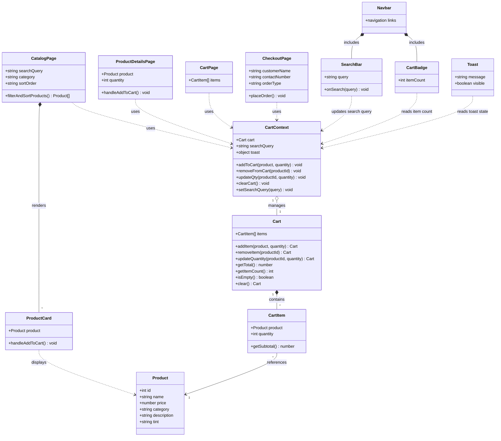

# Campus Café

Campus Café is a responsive campus coffee shop website where students can browse a menu of hot and iced coffee and pastries, search and sort products, manage a shopping cart, and place pickup or dine-in orders through a simple checkout flow. The interface uses a soft lavender color palette and Philippine peso pricing.

## Features

- Browse products by category and sort by price.
- Search the menu by product name.
- View product descriptions and choose quantities.
- Add products to the cart, change quantities, or remove them.
- Review an order summary and complete checkout.
- See an order confirmation after placing an order.

## Tech stack

- React
- Vite
- React Router
- Tailwind CSS

## Getting started

Install dependencies and start the development server:

```bash
npm install
npm run dev
```

Create a production build with:

```bash
npm run build
```

Run the linter with:

```bash
npm run lint
```

## Application architecture


